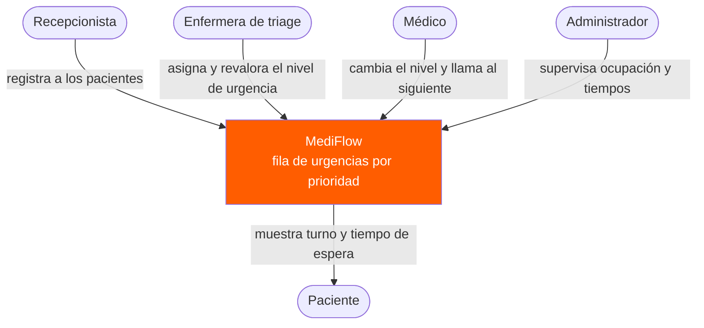
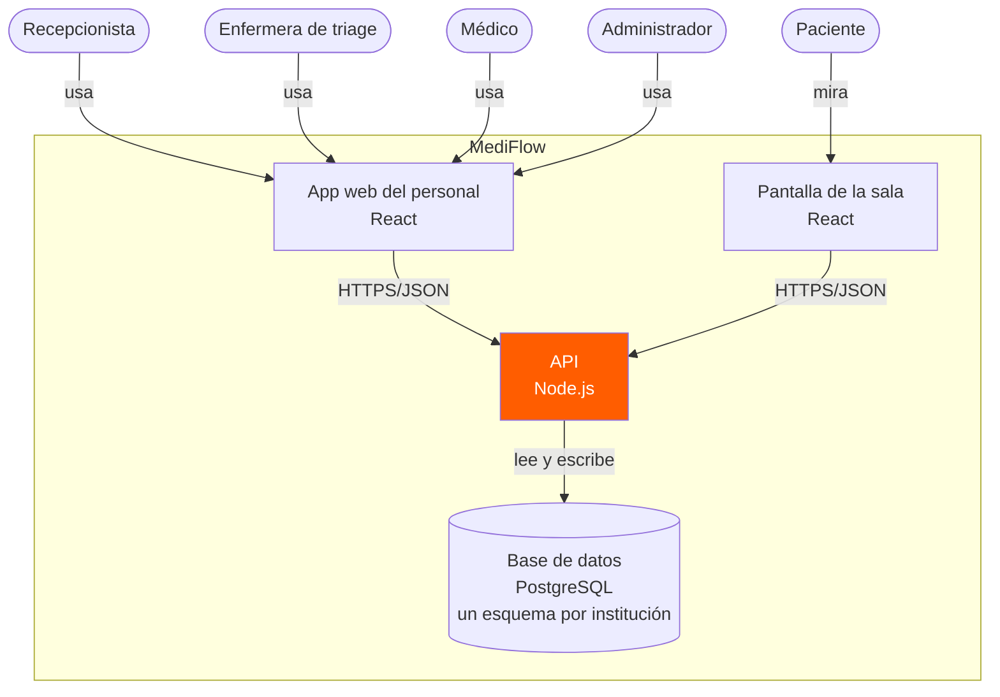
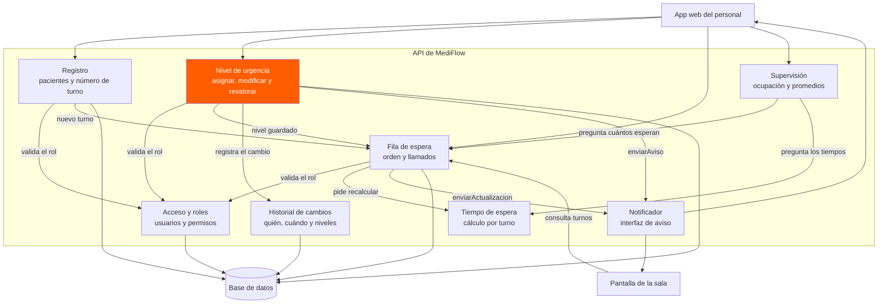

# MediFlow · Diagramas de arquitectura (C4)

**Autor:** Fabio Pérez Gutiérrez
**Curso:** Ingeniería de Software I · SIS3407 · Unidad 3

Los tres primeros niveles del modelo C4, escritos como texto de Mermaid. GitHub los dibuja directamente. Para verlos en otro lado, pega el código en [mermaid.live](https://mermaid.live).

---

## Nivel 1 · Diagrama de contexto

El sistema completo, quién lo usa y con quién habla. No lleva tecnología.

MediFlow no se comunica con ningún sistema externo, porque ningún requisito lo pide. Los cinco actores son los de la especificación de requisitos (sección 2).

---

## Nivel 2 · Diagrama de contenedores

Las piezas que se despliegan y se ejecutan por separado.

- **La pantalla de la sala es un contenedor aparte** de la app del personal. Corre en otro equipo y nunca muestra nombres (RF5).
- **Una sola API y una sola base de datos para todas las instituciones** (SaaS). Cada institución tiene su propio esquema dentro de la base, para poder restaurar una sin afectar a las demás (RNF2).
- La API es la pieza que debe cumplir RNF1 (99.5 % de disponibilidad) y RNF5 (cambios visibles en 5 segundos).

---

## Nivel 3 · Diagrama de componentes

Lo que hay dentro de la API.

| Componente | Requisitos que atiende |
|---|---|
| Acceso y roles | RF2, RF6, RF8, RF9, RNF3 |
| Registro | RF1 |
| Nivel de urgencia | RF2, RF6, RF7 |
| Fila de espera | RF3, RF8, RF9 |
| Tiempo de espera | RF4 |
| Supervisión | RF10 |
| Historial de cambios | RNF4 |
| Notificador | RF5, RF7, RNF5 |

Dos decisiones que se ven en el dibujo:

1. **Los componentes se preguntan entre sí en lugar de leer las tablas del otro.** Tiempo de espera y Supervisión no tocan la base de datos: le preguntan a Fila. Por eso solo cinco componentes se conectan a la base.
2. **El Notificador es una interfaz, no una tecnología.** Hoy avisa a la pantalla de la sala y a la lista de triage. Si después se agrega SMS o una app para el paciente, se agrega otra forma de enviar sin cambiar Fila ni Nivel de urgencia (patrón Adapter).

**Acceso y roles** es donde vive el candidato a polimorfismo: cada tipo de usuario (recepción, triage, médico, administrador) define qué acciones puede hacer. Registro, Nivel de urgencia y Fila solo preguntan "valida el rol".

---

## Supuestos

- La tecnología (React, Node.js, PostgreSQL) es un supuesto. Cámbiala por la que usa tu MediFlow.
- Los nombres `enviarActualizacion` y `enviarAviso` son operaciones propuestas del Notificador.
